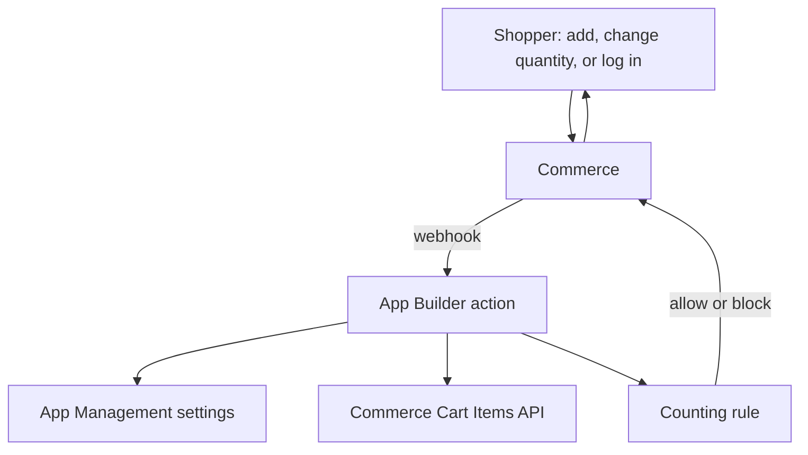

# High-Level Design: Cart Validation

## 1. Flow

1. The shopper changes the cart.
2. Commerce calls one of the three app actions through a webhook.
3. The action reads the settings and the saved cart.
4. The counting rule decides: allow or block.
5. Commerce shows the result to the shopper.

## 2. Components

| Component | What it does | Where |
| --- | --- | --- |
| App config | App name, settings, webhook list | `app.commerce.config.ts` |
| Action list | Declares the three actions | `src/commerce-extensibility-1/ext.config.yaml` |
| Actions (add, update, merge) | Entry points called by Commerce | `src/commerce-extensibility-1/actions/` |
| Shared handler | Runs the steps: read payload, settings, cart, rule, reply | `lib/validate-cart.js` |
| Payload reader | Reads the webhook data into a simple shape | `lib/parse-webhook-payload.js` |
| Counting rule | Calculates the totals and decides | `lib/cart-limit-rule.js` |
| Settings reader | Reads `enabled` and `maxCartQuantity` | `lib/settings.js` |
| Cart reader | Reads the saved cart from Commerce | `lib/commerce-cart-client.js` |
| Message | The block message, kept in one place | `lib/constants.js` |
| Generated files | Created by the SDK, never edited by hand | `.generated/` folders |

## 3. Deployment

- The app is deployed to an App Builder workspace (Stage first, then Production).
- In Commerce Admin, the app is associated and installed through **App Management**. Installing it registers the three webhooks.
- Deploying alone does **not** install the webhooks.
- No database, storage or scheduled jobs.

## 4. External dependencies

| Dependency | Used for |
| --- | --- |
| Commerce webhooks | Calling the app on cart changes |
| App Management settings | The limit and on/off switch |
| Commerce Cart Items REST API | Reading the other cart lines |
| Adobe IMS (OAuth Server-to-Server) | Authentication |

## 5. Failure behaviour

- Any error: the change is allowed and an error is logged.
- Webhooks are `required: false`, so if the app does not answer within 5 seconds, Commerce continues.
- This means the limit is not enforced while the app is down.

See also: [lld.md](lld.md).
