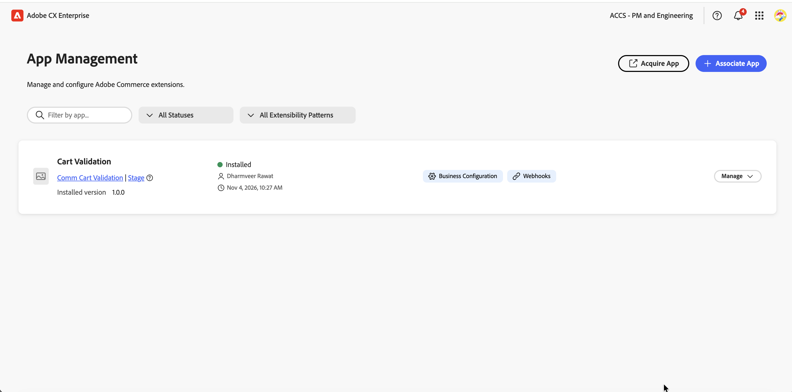
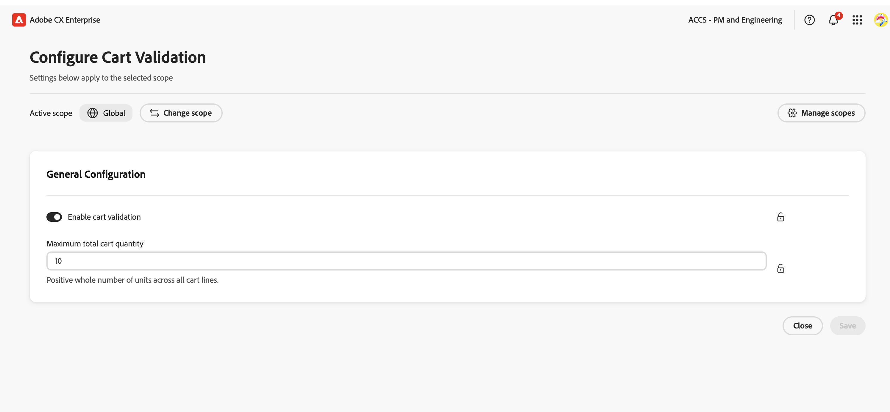
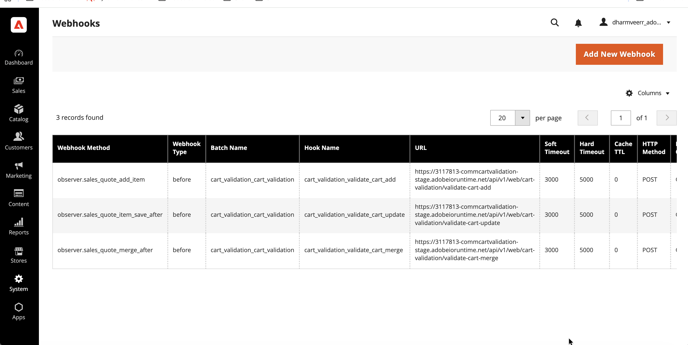
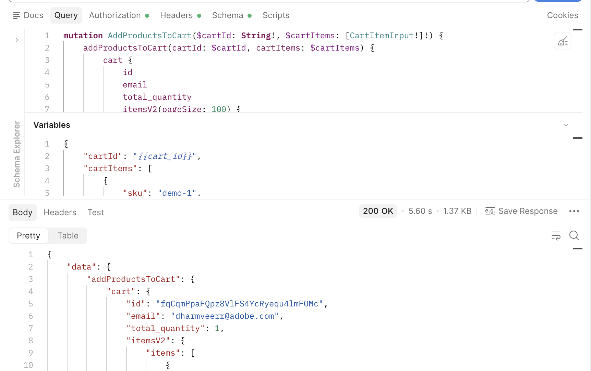
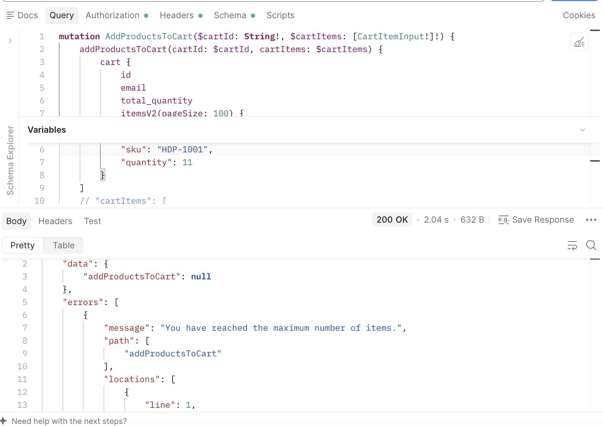

# Cart Validation – Live Test Evidence

| Field | Value |
| --- | --- |
| Date | 2026-11-04 |
| Tester | dharmveerr@adobe.com |
| Commerce instance | Adobe Commerce as a Cloud Service sandbox (na1), tenant `DsqT…` |
| App Builder workspace | CommCartValidation / Stage |
| Code version | `ca38693` + fixes deployed on 2026-11-04 |
| Interface used | Storefront GraphQL (`addProductsToCart`, `updateCartItems`, `removeItemFromCart`, `mergeCarts`) |
| Customer | Logged-in test customer `dharmveerr@adobe.com` (shared catalog: all products) |
| Settings | App Management → Cart Validation: **Enable = Yes**, **Maximum total cart quantity = 10** |
| Block message | `You have reached the maximum number of items.` |

Notation: `A`=HDP-1001, `B`=PSV-3003, `C`=ISS-4004, `D`=HEC-2002 (simple products). `config-1`=Orchard5, `config-2`=ProtectiveCaseforOrchard1-2-3 (configurable, option = Color). Cart totals are the storefront `total_quantity` read before and after each request.

## Summary

| Step | Area | Scenarios | Passed |
| --- | --- | --- | --- |
| 1 | Simple products: add, update, remove (logged-in customer) | 11 | 11 |
| 1 | Settings from App Management: limit change, enable/disable | 4 | 4 |
| 2 | Configurable + simple products | 14 | 14 |
| 3 | Guest cart and guest → customer cart merge | 7 | 7 |
| **Total** | | **36** | **36** |

Known limitations:
- A single API request that adds multiple SKUs at once may exceed the limit.
- Lowering the limit does not affect existing carts: a cart already above the new limit cannot grow, but can still be reduced and checked out.

## Step 1 – Simple products (logged-in customer)

| ID | Cart before | Action | Expected | Actual | Cart after |
| --- | --- | --- | --- | --- | --- |
| S1 | 0 | Add A × 4 | Allowed | Allowed | 4 [A×4] |
| S2 | 4 [A×4] | Add B × 6 | Allowed, total 10 | Allowed | 10 [A×4, B×6] |
| S3 | 10 [A×4, B×6] | Add C × 1 | **Blocked** | **Blocked** + message | 10 (unchanged) |
| U1 | 10 [A×4, B×6] | Update B 6 → 5 | Allowed (decrease) | Allowed | 9 [A×4, B×5] |
| RB1 | 9 | Add C × 1 | Allowed | Allowed | 10 [A×4, B×5, C×1] |
| S4 | 6 [A×6] | Add A × 2 (same SKU) | Allowed, one line A×8 | Allowed | 8 [A×8] |
| S4b | 8 [A×8] | Add A × 3 | **Blocked** | **Blocked** + message | 8 (unchanged) |
| S5 | 9 [A×3, B×3, C×3] | Add D × 2 | **Blocked** | **Blocked** + message | 9 (unchanged) |
| S5b | 9 [A×3, B×3, C×3] | Update B 3 → 5 | **Blocked** | **Blocked** + message | 9 (unchanged) |
| U2 | 9 [A×3, B×3, C×3] | Update B → 0 | Allowed (removes line) | Allowed | 6 [A×3, C×3] |
| R1 | 6 [A×3, C×3] | Remove line C | Allowed | Allowed | 3 [A×3] |

## Step 1 – Settings from App Management (no redeploy)

| ID | Cart before | Setting change | Action | Expected | Actual | Cart after |
| --- | --- | --- | --- | --- | --- | --- |
| S6a | 4 [A×4] | Limit 10 → **5** | Add B × 2 | **Blocked** | **Blocked** + message | 4 (unchanged) |
| S6b | 4 [A×4] | Limit 5 → **10** | Add B × 2 | Allowed | Allowed | 6 [A×4, B×2] |
| D1 | 6 [C×6] | Enable cart validation → **No** | Add B × 6 | Allowed, no limit | Allowed | 12 [C×6, B×6] |
| D2 | 22 (filled while disabled) | Enable cart validation → **Yes** | Add A × 1 | **Blocked** | **Blocked** + message | 22 (unchanged) |

Settings changes apply to live cart requests within about 1 minute of saving in App Management.

## Step 2 – Configurable + simple products

Configurable products are counted by the visible cart line quantity (parent line); the hidden child line is not counted. Same product with a different option is a separate line.

| ID | Cart before | Action | Expected | Actual | Cart after |
| --- | --- | --- | --- | --- | --- |
| C1 | 0 | Add config-1 (Black) × 2 | Allowed | Allowed | 2 |
| C2 | 2 | Add config-1 (Green) × 3 | Allowed, new line | Allowed | 5 (2 lines) |
| C3 | 5 | Add config-2 (Black) × 1 | Allowed | Allowed | 6 |
| C4 | 6 | Add config-2 (White) × 2 | Allowed, **2+3+1+2 = 8** | Allowed | **8** (4 lines) |
| C5 | 8 | Add config-1 (Black) × 1 | Allowed, same line 2 → 3 | Allowed | 9 (4 lines) |
| C6 | 9 | Add config-2 (Black) × 1 | Allowed, total 10 | Allowed | 10 |
| C7 | 10 | Add simple A × 1 | **Blocked** | **Blocked** + message | 10 (unchanged) |
| C8 | 10 | Add config-1 (Green) × 1 | **Blocked** | **Blocked** + message | 10 (unchanged) |
| C9 | 10 | Update config-1 (Green) 3 → 2 | Allowed | Allowed | 9 |
| C10 | 9 | Update config-1 (Green) 2 → 3 | Allowed, total 10 | Allowed | 10 |
| C11 | 10 | Update config-1 (Green) 3 → 4 | **Blocked** | **Blocked** + message | 10 (unchanged) |
| C12 | 10 | Remove config-2 (White) line | Allowed | Allowed | 8 |
| C13 | 8 | Add simple A × 2 (mixed cart) | Allowed, total 10 | Allowed | 10 |
| C14 | 10 | Add simple B × 1 (mixed cart) | **Blocked** | **Blocked** + message | 10 (unchanged) |

## Step 3 – Guest cart and cart merge

Merges use `mergeCarts(source = guest cart, destination = customer cart)`, which runs the same Commerce cart merge used at customer login.

| ID | Customer cart | Guest cart | Action | Expected | Actual | Customer cart after |
| --- | --- | --- | --- | --- | --- | --- |
| G1 | – | 0 | Guest adds A × 6 | Allowed | Allowed | guest 6 |
| G2 | – | 6 | Guest adds B × 4 | Allowed, total 10 | Allowed | guest 10 |
| G3 | – | 10 | Guest adds C × 1 | **Blocked** | **Blocked** + message | guest 10 (unchanged) |
| S7 | 9 [A×5, C×4] | 4 [A×2, B×2] | Merge → 13 | **Blocked** | **Blocked** + message | 9 (unchanged) |
| MG2 | 4 [A×4] | 3 [B×3] | Merge → 7 | Allowed | Allowed | 7 [A×4, B×3] |
| MG3 | 6 [A×6] | 4 [B×2, C×2] | Merge → 10 | Allowed | Allowed | 10 [A×6, B×2, C×2] |
| MG4 | 6 [A×6] | 5 [A×5] | Merge same SKU → 11 | **Blocked** | **Blocked** + message | 6 (unchanged) |

## Webhook subscriptions under test

Installed by App Management (Commerce Admin → System → Webhooks):

| Hook | Commerce event | Type | Action |
| --- | --- | --- | --- |
| `cart_validation_validate_cart_add` | `observer.sales_quote_add_item` | before | `cart-validation/validate-cart-add` |
| `cart_validation_validate_cart_update` | `observer.sales_quote_item_save_after` | before | `cart-validation/validate-cart-update` |
| `cart_validation_validate_cart_merge` | `observer.sales_quote_merge_after` | before | `cart-validation/validate-cart-merge` |

## Screenshot evidence

These screenshots supplement the recorded results above. They are representative examples, not separate proof of every selected scenario. The API response images alone do not establish that a blocked operation left the cart unchanged; those observations are recorded in the scenario tables.

### App installation

Cart Validation is shown as installed in Commerce App Management.

### Global configuration

The Cart Validation configuration form exposes the enable setting and maximum total cart quantity at global scope. Settings-change results are recorded in the settings table above.

### Webhook subscriptions

Commerce lists the three cart-validation webhook subscriptions described above.

### GraphQL add response

Representative storefront GraphQL add request and response. See the scenario tables for the recorded quantities and outcomes of each selected test.

### GraphQL blocked response

An add request with quantity 11 returns the configured message: `You have reached the maximum number of items.` This illustrates the blocking response rather than a specific numbered scenario above.

